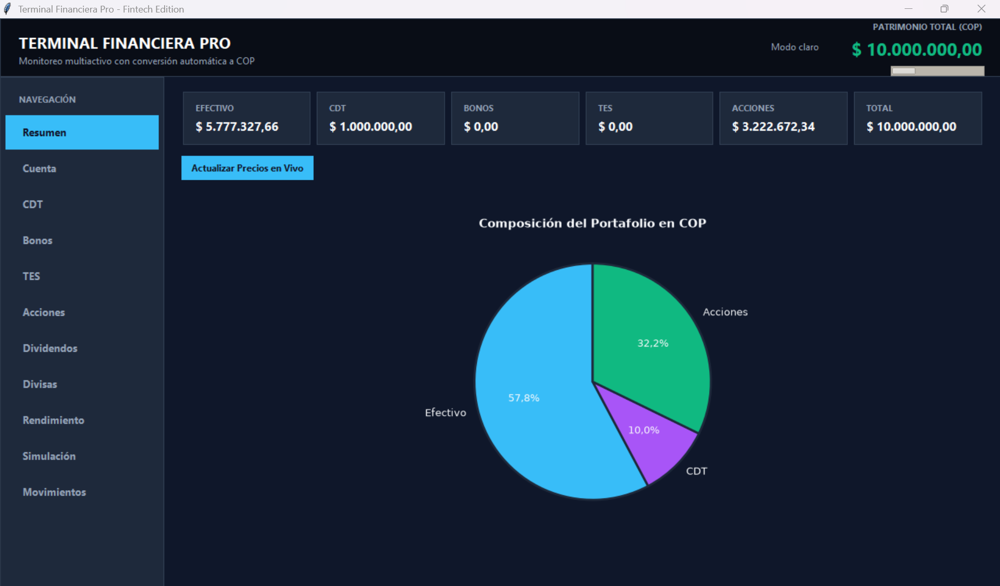
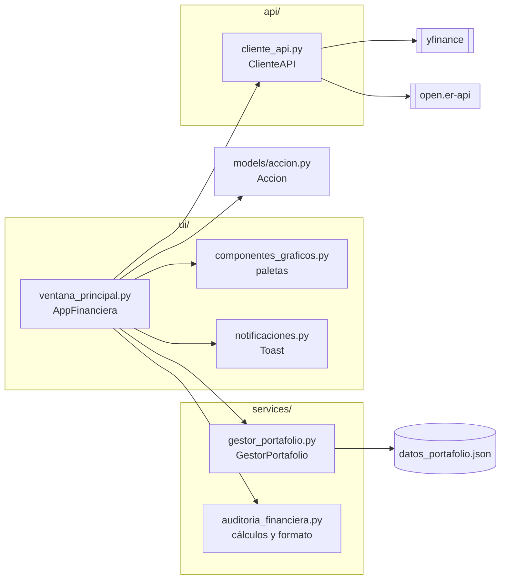
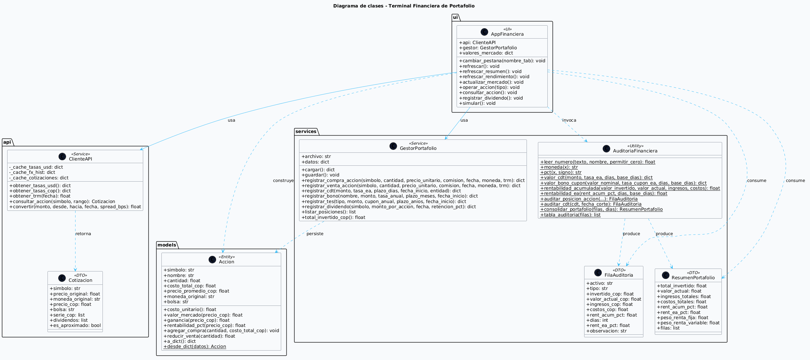

[README.md](https://github.com/user-attachments/files/34758716/README.md)

# Terminal Financiera Profesional de Portafolio


Aplicación de escritorio en Python para el **seguimiento, monitorización y auditoría de portafolios de inversión multiactivos**, con conversión automática a pesos colombianos (COP).



---

## Tabla de contenido

1. [Descripción](#descripción)
2. [Características principales](#características-principales)
3. [Módulos de la aplicación](#módulos-de-la-aplicación)
4. [Arquitectura](#arquitectura)
5. [Requisitos](#requisitos)
6. [Instalación](#instalación)
7. [Ejecución](#ejecución)
8. [Guía de uso paso a paso](#guía-de-uso-paso-a-paso)
9. [Metodología financiera](#metodología-financiera)
10. [Fuentes de datos y caché](#fuentes-de-datos-y-caché)
11. [Persistencia de datos](#persistencia-de-datos)
12. [Catálogo de activos](#catálogo-de-activos)
13. [Diagrama de clases](#diagrama-de-clases)
14. [Solución de problemas](#solución-de-problemas)
15. [Limitaciones conocidas](#limitaciones-conocidas)
16. [Hoja de ruta](#hoja-de-ruta)
17. [Aviso legal](#aviso-legal)
18. [Licencia](#licencia)

---

## Descripción

Sistema académico que permite registrar y evaluar el desempeño de un portafolio compuesto por **renta fija** y **renta variable**, todo expresado en pesos colombianos:

- **Renta variable:** acciones y ETF listados en NYSE y NASDAQ (Coca-Cola, Nike, Apple, Microsoft, Ecopetrol, Bancolombia, SPY, QQQ, entre otros), convertidos a COP con la tasa de cambio USD/COP de cada fecha.
- **Renta fija:** Certificados de Depósito a Término (CDT), bonos corporativos y Títulos de Deuda Pública (TES).
- **Ingresos:** dividendos con retención en la fuente del **4 %** y rendimientos financieros con retención del **7 %**.
- **Costos:** comisiones del bróker, que se incorporan al costo de compra y se descuentan del ingreso de venta.
- **Valoración:** precios de mercado con `yfinance` y tasas de cambio con `open.er-api`.
- **Auditoría:** rentabilidad acumulada y rentabilidad efectiva anual (E.A.) por activo y consolidada.

## Características principales

- Interfaz **Tkinter** con barra lateral de navegación, **tema oscuro y claro** intercambiables y 11 pestañas.
- **Gráficas interactivas** (matplotlib) con tooltips al pasar el cursor: composición del portafolio, histórico de precios en COP, rentabilidad por activo, tasas de cambio y simulación.
- **Notificaciones flotantes (toasts)** no modales que se desvanecen solas, en cuatro tipos: información, éxito, advertencia y error.
- **Consultas en segundo plano** (hilos): la interfaz no se congela mientras se descargan cotizaciones.
- **Lectura de números tolerante**: acepta formato colombiano (`1.234.567,89`) y anglosajón (`1,234,567.89`), con o sin símbolo `$`.
- **Costo promedio ponderado** en compras sucesivas de una misma acción.
- **Persistencia en JSON** con escritura atómica (archivo temporal + `os.replace`) para no corromper los datos si el proceso se interrumpe.
- **Registro de eventos** en consola y en `portafolio.log`.
- **Caché con vencimiento** para no saturar las APIs externas, y degradación controlada cuando una fuente falla (marca la serie como "aproximada").

## Módulos de la aplicación

| Pestaña | Descripción |
|---------|-------------|
| **Resumen** | Seis tarjetas (Efectivo, CDT, Bonos, TES, Acciones y Total), gráfica circular con la composición del portafolio y botón para actualizar precios en vivo. |
| **Cuenta** | Depósitos y retiros de efectivo en COP, con validación de saldo. |
| **CDT** | Apertura con monto, plazo (90, 180, 360 o 540 días) y tasa E.A.; interés compuesto base 360. Liquidación de certificados. |
| **Bonos** | Compra de bonos corporativos indicando emisor, monto, tasa anual y plazo en meses; redención. |
| **TES** | Adquisición de TES (tasa fija) con cupón anual y plazo en años; redención. |
| **Acciones** | Consulta de precio en vivo con conversión a COP, gráfico histórico, compra y venta con comisión de bróker y tabla de tenencias con ganancia o pérdida. |
| **Dividendos** | Registro de dividendos por acción en posición, con retención del 4 % y abono del neto a la cuenta. |
| **Divisas** | Tabla y gráfica de nueve monedas (USD, EUR, GBP, CHF, CAD, MXN, BRL, PEN y JPY) expresadas en COP. |
| **Rendimiento** | Tabla de auditoría con invertido, valor actual, ganancia, rentabilidad acumulada y E.A. por activo, más consolidado y gráfica de barras. |
| **Simulación** | Simulador histórico: "si hubiera invertido X pesos en esta acción hace N meses o años". |
| **Movimientos** | Historial completo de depósitos, retiros y operaciones. |

## Arquitectura

El proyecto sigue una separación por capas: interfaz, servicios de dominio, acceso a datos externos y modelos.



### Estructura de carpetas

```
Proyecto-Finance/
├── main.py                          # Punto de entrada y configuración de logging
├── requirements.txt                 # Dependencias
├── .gitignore
├── LICENSE
├── README.md
├── api/
│   └── cliente_api.py               # yfinance + open.er-api, caché y conversión de divisas
├── models/
│   └── accion.py                    # Entidad Accion (costo promedio, ganancia, rentabilidad)
├── services/
│   ├── gestor_portafolio.py         # Persistencia, catálogo y registro validado de operaciones
│   ├── auditoria_financiera.py      # Fórmulas financieras, retenciones y formato numérico
│   └── datos_portafolio.json        # Se genera al usar la app (ignorado por Git)
├── ui/
│   ├── componentes_graficos.py      # Paletas de color clara y oscura
│   ├── notificaciones.py            # Toasts flotantes
│   └── ventana_principal.py         # Interfaz Tkinter (pestañas, gráficas, eventos)
└── docs/
    ├── capturas/
    │   ├── resumen.png
    │   └── uml.png
    └── uml/
        └── diagrama_clases.puml
```

### Responsabilidad de cada módulo

| Módulo | Responsabilidad |
|--------|-----------------|
| `main.py` | Configura el logging (consola y `portafolio.log`), crea `AppFinanciera` y captura errores fatales al arrancar. |
| `api/cliente_api.py` | Clase `ClienteAPI` y DTO `Cotizacion`. Obtiene tasas spot, serie USD/COP, cotizaciones, dividendos históricos y bolsa de listado; convierte entre divisas usando USD como pivote. |
| `models/accion.py` | Dataclass `Accion`: costo unitario, valor de mercado, ganancia, rentabilidad, compra con costo promedio ponderado y venta que reduce la posición al costo promedio. |
| `services/gestor_portafolio.py` | Carga y guarda el JSON, define el catálogo de acciones y ofrece métodos `registrar_*` con validación estricta (montos positivos, fechas ISO, saldo suficiente, posición disponible). |
| `services/auditoria_financiera.py` | Lectura de números, formato de moneda y porcentaje, valoración de CDT y bonos, rentabilidad acumulada y E.A., y consolidación del portafolio (`FilaAuditoria`, `ResumenPortafolio`). |
| `ui/ventana_principal.py` | Clase `AppFinanciera` (hereda de `tk.Tk`): construye las pestañas, lanza consultas en hilos, dibuja las gráficas y refresca las vistas tras cada operación. |
| `ui/componentes_graficos.py` | Paletas `PALETA_OSCURA` y `PALETA_CLARA` y función `obtener_paleta()`. |
| `ui/notificaciones.py` | Clase `Toast`: aviso flotante con desvanecimiento progresivo. |

## Requisitos

- **Python 3.10 o superior**
- **Tkinter** (incluido en la instalación estándar de Python en Windows y macOS; en Linux puede requerir `sudo apt install python3-tk`)
- **Conexión a internet** para cotizaciones y tasas de cambio
- Dependencias de `requirements.txt`:

| Paquete | Versión | Uso |
|---------|---------|-----|
| `requests` | `>=2.31,<3.0` | Consulta de tasas de cambio a `open.er-api` |
| `matplotlib` | `>=3.8,<4.0` | Gráficas embebidas en Tkinter (backend `TkAgg`) |
| `yfinance` | `>=0.2.40,<0.3` | Precios, históricos, dividendos y USD/COP |
| `numpy` | `>=1.26,<3.0` | Dependencia numérica de matplotlib y yfinance |

## Instalación

**Windows**

```bash
git clone https://github.com/isaac77988/repositorio-proyecto3
cd repositorio-proyecto3
python -m venv venv
venv\Scripts\activate
pip install -r requirements.txt
```

**macOS / Linux**

```bash
git clone https://github.com/isaac77988/repositorio-proyecto3
cd repositorio-proyecto3
python3 -m venv venv
source venv/bin/activate
pip install -r requirements.txt
```

> La carpeta que crea `git clone` toma el nombre del repositorio. Si trabajas desde el `.zip`, entra a la carpeta `Proyecto-Finance`.

## Ejecución

```bash
python main.py
```

La aplicación abre en **modo oscuro** (el tema se alterna desde la propia interfaz) con once pestañas navegables. El archivo `datos_portafolio.json` se crea automáticamente la primera vez que se registra una operación y se guarda en la carpeta `services/`.

Para probar solo la capa de datos de mercado, sin interfaz:

```bash
python -m api.cliente_api
```

Imprime la TRM aproximada y la cotización en COP de NKE, KO y AAPL.

## Guía de uso paso a paso

1. **Cuenta:** deposita efectivo en COP. Sin saldo no se puede abrir ninguna inversión.
2. **CDT:** indica monto, plazo y tasa E.A. y pulsa *Abrir CDT*. La tabla muestra el valor actual y el valor final al vencimiento.
3. **Bonos / TES:** adquiere títulos de renta fija indicando tasa y plazo.
4. **Acciones:** elige una empresa del catálogo (puedes escribir para filtrar), pulsa **Consultar** para traer el precio en vivo y luego **Comprar** o **Vender** indicando cantidad y comisión del bróker.
5. **Dividendos:** registra el valor por acción en COP; la app calcula el bruto sobre tu posición, descuenta el 4 % y abona el neto.
6. **Divisas:** consulta las tasas de cambio del día frente al peso.
7. **Rendimiento:** revisa rentabilidad acumulada y E.A. por activo y del portafolio. Pulsa *Actualizar Rendimientos* para traer precios actuales de todas tus acciones.
8. **Simulación:** prueba una inversión histórica en cualquier acción del catálogo, con periodos de 1 mes hasta 10 años.
9. **Movimientos:** audita cada operación registrada.

> **Nota:** los precios de mercado no se guardan entre sesiones. Al abrir la app, las acciones se valoran a su costo hasta que pulses *Actualizar Precios en Vivo* (Resumen) o *Consultar* (Acciones).

## Metodología financiera

### Retenciones aplicadas

| Concepto | Retención |
|----------|-----------|
| Dividendos de acciones | 4 % |
| Rendimientos financieros (CDT, bonos, TES) | 7 % |

Constantes definidas en `services/auditoria_financiera.py`: `RETENCION_DIVIDENDOS_PCT` y `RETENCION_RENDIMIENTOS_PCT`.

### Fórmulas

**Interés compuesto de un CDT (base 360):**

$$
\text{Interés bruto} = M \times \left[(1 + i_{EA})^{d/360} - 1\right]
$$

donde $M$ es el monto, $i_{EA}$ la tasa efectiva anual y $d$ los días transcurridos.

**Rentabilidad acumulada:**

$$
R_{acum} = \frac{V_{actual} + \text{Ingresos} - \text{Costos} - V_{invertido}}{V_{invertido}} \times 100
$$

**Rentabilidad efectiva anual (E.A.):**

$$
R_{EA} = \left[(1 + R_{acum})^{365/d} - 1\right] \times 100
$$

**Costo promedio ponderado** (compras sucesivas):

$$
\text{Precio promedio} = \frac{\text{Costo total acumulado (con comisiones)}}{\text{Cantidad total}}
$$

**Costo de una compra de acciones en COP:**

$$
\text{Costo} = \text{Cantidad} \times \text{Precio en USD} \times \text{TRM} + \text{Comisión}
$$

### Ejemplos numéricos

**CDT.** Capital de \$1.000.000 a 10 % E.A. por 180 días:

| Concepto | Valor |
|----------|-------|
| Valor final | \$1.048.808,85 |
| Interés bruto | \$48.808,85 |
| Retención 7 % | \$3.416,62 |
| Interés neto | \$45.392,23 |

**Dividendo.** 10 acciones con un dividendo de \$2.000 COP por acción:

| Concepto | Valor |
|----------|-------|
| Bruto | \$20.000 |
| Retención 4 % | \$800 |
| Neto abonado a la cuenta | \$19.200 |

**Rentabilidad E.A.** Una rentabilidad acumulada del 5 % obtenida en 90 días equivale a $(1{,}05)^{365/90} - 1 \approx$ **21,88 % E.A.**

### Tratamiento de cada instrumento en la interfaz

| Instrumento | Valoración mostrada | Al liquidar o redimir |
|-------------|--------------------|-----------------------|
| CDT | Interés compuesto base 360 sobre los días transcurridos (tope: el plazo) | Si venció: paga el valor final. Si no: devuelve solo el capital. |
| Bono | Crecimiento lineal desde el capital hasta el valor final (interés simple del cupón anual) | Si venció: valor final. Si no: capital. |
| TES | Interés simple con la tasa del cupón sobre los días transcurridos | Paga el valor acumulado a la fecha. |
| Acción | Cantidad × precio actual en COP (o costo, si aún no se consulta el precio) | Venta: ingreso bruto menos comisión, con reducción al costo promedio. |

## Fuentes de datos y caché

| Fuente | Uso | Vigencia de la caché |
|--------|-----|----------------------|
| `yfinance` | Precio actual, histórico diario, dividendos, bolsa y moneda de cada símbolo | Cotizaciones: 5 minutos |
| `yfinance` (`COP=X`) | Serie histórica USD/COP para convertir cada día a pesos | 6 horas |
| `open.er-api.com` | Tasas spot frente al USD para la pestaña Divisas y monedas distintas de USD | 15 minutos |

Comportamiento ante fallas:

- Los tiempos de espera son de 3 s para conectar y 10 s para leer, de modo que la app falla rápido si un servicio no responde.
- Si `open.er-api` falla y ya había tasas en caché, se siguen usando; si no, se informa el error.
- Si no hay serie histórica USD/COP, se convierte con una **tasa única** y la cotización queda marcada como `es_aproximado` (la interfaz muestra *serie FX aproximada*).
- Los activos que cotizan en monedas distintas de USD o COP se convierten con tasa spot única vía USD.

> **Importante:** `COP=X` de Yahoo Finance es un USD/COP interbancario aproximado, **no la TRM oficial** certificada por la Superintendencia Financiera. Para auditorías estrictas conviene sustituirla por la serie oficial del Banco de la República.

## Persistencia de datos

Los datos se guardan en `services/datos_portafolio.json`, un archivo local que **no se sube a Git** (está en `.gitignore`). La escritura es atómica: se escribe un temporal en el mismo directorio y luego se reemplaza el original con `os.replace`, de modo que un cierre inesperado no deja el archivo a medias. Si el JSON está dañado o no existe, la app arranca con un portafolio vacío.

Estructura general:

```json
{
  "esquema": 1,
  "saldo": 5777327.66,
  "cdts": [
    {
      "monto": 1000000.0,
      "tasa": 10.0,
      "plazo": 180,
      "fecha_inicio": "2026-11-11",
      "vence": "2027-05-10",
      "final": 1048808.85
    }
  ],
  "bonos": [],
  "tes": [],
  "acciones": {
    "KO": {
      "simbolo": "KO",
      "nombre": "Coca-Cola (KO)",
      "cantidad": 10.0,
      "costo_total_cop": 3222672.34,
      "precio_promedio_cop": 322267.23,
      "moneda_original": "USD",
      "bolsa": "DESCONOCIDA"
    }
  },
  "dividendos": [],
  "movimientos": [
    { "fecha": "2026-11-11 22:10", "tipo": "Depósito", "detalle": "Cuenta de ahorros", "monto": 10000000.0 }
  ]
}
```

Para **reiniciar el portafolio**, cierra la aplicación y elimina `services/datos_portafolio.json`. Haz una copia antes si quieres conservar el historial.

## Catálogo de activos

La lista es fija y está definida en `CATALOGO_ACCIONES` (`services/gestor_portafolio.py`). El selector permite filtrar escribiendo.

| Sector | Símbolos |
|--------|----------|
| Consumo | KO (Coca-Cola), PEP (PepsiCo), NKE (Nike), MCD (McDonald's) |
| Tecnología | AAPL (Apple), MSFT (Microsoft), GOOGL (Alphabet), AMZN (Amazon), NVDA (NVIDIA), TSLA (Tesla) |
| Finanzas | JPM (JPMorgan Chase), V (Visa) |
| Energía | XOM (ExxonMobil) |
| Salud | JNJ (Johnson & Johnson) |
| Telecomunicaciones | T (AT&T) |
| Colombia (ADR en NYSE) | EC (Ecopetrol), CIB (Bancolombia) |
| ETF | SPY (S&P 500), QQQ (Nasdaq 100) |

Para añadir una empresa, agrega una tupla `(símbolo, nombre, sector, bolsa)` a la lista.

## Diagrama de clases



También disponible en formato PlantUML: [docs/uml/diagrama_clases.puml](docs/uml/diagrama_clases.puml).

## Solución de problemas

| Síntoma | Causa probable | Solución |
|---------|----------------|----------|
| `ModuleNotFoundError: No module named 'tkinter'` | Python sin Tkinter (común en Linux) | `sudo apt install python3-tk` |
| `Símbolo sin datos` al consultar | Yahoo no devolvió información (símbolo inválido, límite de peticiones o sin red) | Espera unos minutos y reintenta; verifica la conexión |
| `Sin tasas disponibles` | `open.er-api` no respondió y no hay caché | Revisa internet o reintenta; las tasas se cachean 15 minutos |
| Las acciones aparecen con "—" en Rendimiento | No se han consultado los precios en esta sesión | Pulsa *Actualizar Precios en Vivo* o *Consultar* |
| La etiqueta dice *serie FX aproximada* | Falló la serie histórica USD/COP o la moneda no es USD | Es informativo: la conversión usó una tasa única |
| La ventana se ve cortada | Resolución baja | La app exige un mínimo de 1150 × 720 px |
| Quiero ver qué falló | | Revisa `portafolio.log` en la carpeta desde donde ejecutas `python main.py` |

## Limitaciones conocidas

Para mantener la documentación fiel al código, estos son los puntos donde el comportamiento actual difiere de lo que podría esperarse:

- **Retención del 7 % en renta fija:** las funciones de `auditoria_financiera.py` (`valor_cdt`, `valor_bono_cupon`) la calculan, pero las pestañas CDT, Bonos y TES valoran y liquidan hoy con el interés **bruto**. La retención del 4 % en dividendos sí se aplica en la interfaz.
- **Capa de servicios no conectada del todo:** la interfaz modifica los datos directamente en lugar de usar los métodos `registrar_*` de `GestorPortafolio`, que son los que incluyen la validación estricta. Además, los registros de CDT, bonos y TES que genera la interfaz usan claves distintas (`tasa`, `plazo`) a las del gestor (`tasa_ea`, `plazo_dias`, `id`).
- **Rentabilidad E.A. de acciones:** en la pestaña Rendimiento se calcula con un periodo fijo de 30 días, no con la fecha real de compra. La fila TOTAL no muestra E.A.
- **Insignia "% Día":** en la tabla de acciones es un valor ilustrativo fijo, no la variación diaria real.
- **Comisiones en la rentabilidad:** se incluyen en el costo de compra (y por tanto en la rentabilidad de las acciones), pero no se registran como columna de costos independiente.
- **Bonos y TES:** el cálculo usa interés simple lineal; no modela precios de mercado secundario, cupones periódicos ni reinversión.
- **Sin pruebas automatizadas** ni empaquetado como ejecutable.
- **Impuestos:** solo se modelan las dos retenciones indicadas; no hay GMF, ganancia ocasional ni otros tributos.

## Hoja de ruta

- [ ] Conectar la interfaz a `GestorPortafolio` y a `auditar_*` para unificar validaciones y esquema de datos.
- [ ] Aplicar la retención del 7 % en la valoración y liquidación de CDT, bonos y TES.
- [ ] Calcular la rentabilidad E.A. de acciones con la fecha real de compra y mostrar E.A. consolidada.
- [ ] Reemplazar `COP=X` por la TRM oficial del Banco de la República.
- [ ] Guardar el último precio de cada acción para valorar el portafolio al abrir la app.
- [ ] Mostrar la variación diaria real en la tabla de acciones.
- [ ] Pruebas unitarias con `pytest` para `auditoria_financiera.py` y `gestor_portafolio.py`.
- [ ] Exportar movimientos y auditoría a CSV o Excel.
- [ ] Empaquetar como ejecutable con PyInstaller.

## Aviso legal

Este software es un proyecto **académico y educativo**. Los precios, tasas de cambio y cálculos tributarios son aproximados y no constituyen asesoría financiera, contable ni tributaria. No lo utilices como única base para decisiones de inversión ni para declaraciones oficiales.

## Licencia

Distribuido bajo la licencia **MIT**. Consulta el archivo [LICENSE](LICENSE) para más información.
